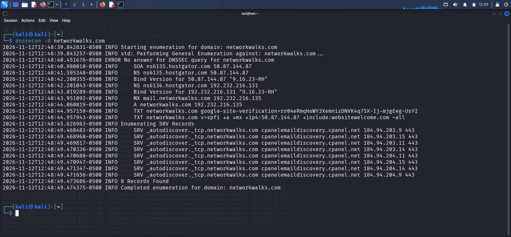

# PENETRATION TESTING REPORT
## FOOTPRINTING & NETWORK SCANNING PHASES
W2-PM-FINAL | CYBERSECURITY | NETWORKWALKS

---

### Project Details

| Field | Information |
| :--- | :--- |
| Pentester Name | K. M. Al Tasin Kabir |
| Program/Batch | B084-Networkwalks |
| Date | 14 Nov 2026 |
| Modules Completed | W2-PM1 (Multiple Kali Tools)<br>W2-PM5 (Zenmap Scanning) |
| Client/Target | 1. Networkwalks (secured written permission already)<br>2. My own local LAN Network |
| Permission Secured | Yes |
| Phases Covered | Phase 1: Reconnaissance & Footprinting<br>Phase 2: Scanning & Network Discovery<br>Phase 3-5: In Progress |

---


## 1. LIABILITY DISCLAIMER

I have performed these activities only on the systems & devices where I had secured written permission or the devices/systems that I own myself. All these materials are for education and research purpose only. Do not use anything from here to break the law.

---

## 2. INTRODUCTION

This report covers footprinting the networkwalks.com domain using multiple Kali Linux tools (W2-PM1) and scanning my own local network with Zenmap (W2-PM5). One module covers the footprinting phase and the other covers the scanning phase, so together they show how an attacker moves from gathering public information to mapping live hosts on a network. It is the Week 2 part of my ongoing internship program at Networkwalks.
All commands were run in Kali Linux (footprinting) and on a Windows PC with Zenmap installed (scanning). Every step below includes the exact command used, the result I observed, a screenshot as evidence, and a short note on why the finding matters from an attacker's point of view.

---


## 3. TOOLS AND TECHNOLOGIES USED

| Tool              | Purpose                                       |
| ----------------- | --------------------------------------------- |
| Kali Linux        | Primary penetration testing environment       |
| WHOIS             | Domain registration and ownership information |
| WhatWeb           | Website technology fingerprinting             |
| Nslookup          | DNS resolution and IP address identification  |
| cURL              | HTTP response header inspection               |
| WAFW00F           | Web Application Firewall detection            |
| DNSRecon          | DNS enumeration                               |
| Nmap              | Network discovery and port scanning           |
| Zenmap            | Graphical interface for Nmap scanning         |
| Windows 11        | Host operating system                         |
| Oracle VirtualBox | Virtualization environment                    |

---

##4. Activities Performed

#4.1 Footprinting & Reconnaissance

I performed reconnaissance against the networkwalks.com domain using six Kali Linux tools: WHOIS, WhatWeb, Nslookup, Curl, Wafw00f and DNSRecon. Each tool was used to collect a different type of information about the target.
First, I used WHOIS to obtain publicly available domain registration information and identify the domain’s name servers. The results provided information about the domain registration and hosting infrastructure.
I then used WhatWeb to identify technologies used by the website. The results identified WordPress 7.0.4 and WP Download Manager 3.3.58, along with other information exposed by the website.
Using Nslookup, I resolved the domain name to its IP address. The provided result identified 192.232.216.135.

---

# 7. FOOTPRINTING AND RECONNAISSANCE

Footprinting is the process of gathering information about a target before conducting deeper security assessments.

During this phase, I used several Kali Linux tools to examine different aspects of the target's publicly accessible infrastructure.

## 7.1 WHOIS Lookup

**Tool:** WHOIS

**Command:**

```bash
whois networkwalks.com
```

**Purpose:**

To retrieve publicly available domain registration information, including registrar details, registration dates, expiry dates, and name servers.

**Findings:**

- Domain registration information was retrieved.
- Registrar details were identified.
- Domain creation and expiry dates were observed.
- Name server information was collected.
- Registrant information was privacy-protected.
- HostGator hosting infrastructure was identified from the available records.

**Security Relevance:**

WHOIS information can provide useful intelligence during reconnaissance. Attackers may use publicly available registration information to understand domain ownership and hosting infrastructure.

**Evidence:**


---

## 7.2 WhatWeb – Technology Fingerprinting

**Tool:** WhatWeb

**Commands:**

```bash
whatweb networkwalks.com
```

```bash
whatweb -v networkwalks.com
```

**Purpose:**

To identify technologies and components used by the target website.

**Findings:**

- WordPress was identified as the website's content management system.
- WordPress version 7.1.4 was reported.
- WP Download Manager plugin version 3.3.76 was identified.
- Additional server and web technology information was collected.

**Security Relevance:**

Technology fingerprinting helps security professionals understand the software components running on a website.

Exposed software versions can be compared against known security advisories to determine whether further investigation is necessary.

**Evidence:**
### WhatWeb Technology Detection


---

## 7.3 Nslookup – DNS Resolution

**Tool:** Nslookup

**Command:**

```bash
nslookup networkwalks.com
```

**Purpose:**

To resolve the target domain name into its corresponding IP address.

**Findings:**

- The DNS resolution process was performed.
- The domain's IP address was retrieved.
- The DNS server responded to the query.

**Security Relevance:**

DNS resolution helps identify the IP infrastructure associated with a domain. This information can support subsequent network reconnaissance and infrastructure analysis.

**Evidence:**


---

## 7.4 cURL – HTTP Header Inspection

**Tool:** cURL

**Command:**

```bash
curl -I https://networkwalks.com
```

**Purpose:**

To inspect HTTP response headers returned by the target web server.

**Findings:**

- The server returned an HTTP 200 OK response.
- Server response information was collected.
- Content-Type and other response headers were inspected.
- HTTPS communication was successfully established.

**Security Relevance:**

HTTP response headers can reveal information about server configuration and security controls.

Security-related headers such as Content-Security-Policy, Strict-Transport-Security, and X-Content-Type-Options should be reviewed to determine whether appropriate protections are implemented.

**Evidence:**


---

## 7.5 WAFW00F – Web Application Firewall Detection

**Tool:** WAFW00F

**Commands:**

```bash
wafw00f networkwalks.com
```

```bash
wafw00f https://networkwalks.com
```

**Purpose:**

To identify whether the target website uses a Web Application Firewall.

**Findings:**

- ModSecurity (SpiderLabs) was identified.
- The results indicated the presence of a Web Application Firewall.

**Security Relevance:**

A Web Application Firewall helps monitor and filter potentially malicious HTTP traffic.

Identifying the WAF technology provides insight into the defensive mechanisms protecting a web application.

**Evidence:**


---

## 7.6 DNSRecon – DNS Enumeration

**Tool:** DNSRecon

**Command:**

```bash
dnsrecon -d networkwalks.com
```

**Purpose:**

To enumerate DNS records associated with the target domain.

**Findings:**

- Name server records were identified.
- Mail exchange records were examined.
- TXT and SPF records were observed.
- Additional DNS-related records were collected.
- BIND 9.16.23 was reported in the scan results.
- cPanel-related DNS records were identified.

**Security Relevance:**

DNS records provide information about an organization's internet infrastructure.

Misconfigured or unnecessary DNS records can expose additional infrastructure details and potentially create security risks.

**Evidence:**



---

## 7.7 Nmap – Port Scanning and Service Detection

**Tool:** Nmap

**Commands:**

```bash
nmap -sV networkwalks.com
```

```bash
nmap -T4 -A -v networkwalks.com
```

**Purpose:**

To identify open ports, discover running services, and collect service version information from the target.

**Findings:**

- The target responded to network scanning.
- Ports 80 and 443 were identified as open.
- HTTP and HTTPS services were detected.
- Service version detection was performed.
- Additional port states were examined.

**Security Relevance:**

Open ports indicate services accessible through the network.

Identifying exposed services helps security professionals evaluate the attack surface and determine whether unnecessary services should be disabled.

**Evidence:**


---

# 8. ZENMAP – GRAPHICAL NETWORK SCANNING

Zenmap provides a graphical interface for Nmap, making it easier to examine scan results, host information, network topology, and exposed services.

For this exercise, I used scanme.nmap.org, the official Nmap test target.

**Target:** scanme.nmap.org

**IP Address:** 45.33.32.156

**Scan Profile:** Intense Scan

**Command:**

```bash
nmap -T4 -A -v scanme.nmap.org
```

## 8.1 Zenmap Intense Scan

**Purpose:**

To perform detailed network scanning involving service detection, operating system detection, and traceroute.

**Findings:**

- The target was identified as live.
- Service detection was performed.
- Operating system detection was attempted.
- Traceroute information was collected.
- Open ports and associated services were examined.

**Evidence:**


---

## 8.2 Ports and Hosts View

**Purpose:**

To examine discovered hosts, open ports, and associated services through Zenmap's graphical interface.

**Findings:**

- Multiple open ports were identified.
- Services associated with the discovered ports were displayed.
- Port information was organized for easier examination.
- The interface made it easier to review exposed services.

**Evidence:**


---

## 8.3 Network Topology View

**Purpose:**

To visualize the network path between the scanning machine and the target.

**Findings:**

- The topology view displayed the relationship between the scanning machine and target.
- Network hops were visualized.
- The graphical representation provided a clearer understanding of the route to the target.

**Evidence:**


---

## 8.4 Hosts Viewer

**Purpose:**

To examine discovered host information and operating system detection results.

**Findings:**

- The target host information was displayed.
- Linux was reported as the operating system match.
- Open port information was available.
- Host details were presented in a centralized interface.

**Evidence:**


---

# 9. ERRORS ENCOUNTERED AND SOLUTIONS

During the practical exercises, I encountered some technical challenges while working with the tools.

| Error / Challenge          | Possible Cause                                     | Solution                                        |
| -------------------------- | -------------------------------------------------- | ----------------------------------------------- |
| DNSRecon command not found | Tool was not installed                             | Installed DNSRecon using APT                    |
| WHOIS timeout              | Network delay or server response delay             | Retried the command after checking connectivity |
| cURL connection delay      | Slow network or HTTPS handshake delay              | Checked connectivity and retried                |
| WAFW00F scan delay         | Multiple HTTP requests during detection            | Allowed the scan to complete                    |
| Nmap scan delay            | Extensive scanning and network filtering           | Reviewed scan options and allowed completion    |
| Zenmap scan delay          | Intense Scan performs several detection activities | Waited for the scan to finish                   |

**Lesson Learned:**

Troubleshooting is an important part of penetration testing. Understanding why a tool fails makes it easier to resolve problems and obtain reliable results.

---

# 10. RISK ANALYSIS AND SECURITY OBSERVATIONS

The following table summarizes the security observations made during the assessment.

| No. | Observation                                     | Potential Security Implication                                 | Suggested Priority |
| --- | ----------------------------------------------- | -------------------------------------------------------------- | ------------------ |
| 1   | Public WHOIS information                        | Can support infrastructure reconnaissance                      | Low                |
| 2   | Web technology fingerprinting                   | May reveal software requiring security updates                 | Medium             |
| 3   | Domain IP address identification                | Provides information about hosting infrastructure              | Low                |
| 4   | HTTP response headers                           | May reveal configuration details or missing security controls  | Medium             |
| 5   | WAF technology identification                   | Reveals information about defensive architecture               | Low                |
| 6   | DNS records exposed                             | Can assist infrastructure enumeration                          | Medium             |
| 7   | HTTP and HTTPS ports exposed                    | Increases the externally accessible attack surface             | Medium             |
| 8   | Multiple services identified on scanme.nmap.org | Provides information about exposed services on the test target | Informational      |
| 9   | Operating system fingerprinting                 | May help identify platform-specific attack opportunities       | Low                |

**Risk Assessment Note:**

These observations represent potential security considerations, not confirmed vulnerabilities.

No exploitation or vulnerability verification was performed. The risk priorities are preliminary and should be validated through further authorized assessment.

---

# 11. SECURITY RECOMMENDATIONS

Based on the observations, the following defensive recommendations are proposed:

1. **Domain Information:** Review publicly available registration information and enable domain privacy where appropriate.

2. **Software Updates:** Keep WordPress, plugins, and other web components updated.

3. **Infrastructure Protection:** Apply appropriate network controls to protect the origin server.

4. **HTTP Security:** Review HTTP response headers and implement appropriate security headers.

5. **WAF Configuration:** Maintain updated ModSecurity rulesets and regularly review security logs.

6. **DNS Security:** Regularly audit DNS records and remove obsolete entries.

7. **Port Management:** Disable unnecessary services and restrict access to sensitive ports.

8. **Operating System Security:** Maintain current security patches and apply appropriate host firewall policies.

---

# 12. LESSONS LEARNED

This practical exercise improved my understanding of several cybersecurity concepts.

**1. Footprinting and Reconnaissance**

I learned how to gather information about a target using different reconnaissance tools.

**2. Domain Intelligence**

I gained practical experience retrieving domain registration and DNS information using WHOIS and DNSRecon.

**3. Technology Fingerprinting**

I learned how WhatWeb identifies website technologies and software components.

**4. HTTP Analysis**

I understood how to inspect HTTP response headers using cURL.

**5. Web Application Firewall Detection**

I gained experience identifying WAF technologies using WAFW00F.

**6. Network Scanning**

I learned how Nmap identifies active hosts, open ports, and running services.

**7. Network Visualization**

I explored Zenmap's graphical features, including Ports/Hosts, Topology, and Hosts Viewer.

**8. Technical Documentation**

I learned the importance of documenting commands, evidence, findings, and recommendations in a structured penetration testing report.

---

# 13. CONCLUSION

Week 2 of my Cybersecurity Internship at Networkwalks provided an opportunity to gain practical experience in footprinting, reconnaissance, network scanning, and security analysis.

Throughout the exercise, I worked with several Kali Linux tools, including WHOIS, WhatWeb, Nslookup, cURL, WAFW00F, DNSRecon, and Nmap.

I also used Zenmap to perform graphical network scanning against the official Nmap test target, scanme.nmap.org.

One important takeaway was that reconnaissance plays a significant role in understanding an organization's digital infrastructure before deeper security assessments are conducted.

I also learned that identifying an open port, exposed technology, or publicly available information does not automatically mean a vulnerability exists. Proper validation and contextual analysis are necessary before assigning security risks.

Overall, this exercise strengthened my practical understanding of reconnaissance methodologies, network scanning, security observations, and professional penetration testing documentation.

---

---

# 14. REFERENCES

- Networkwalks: [https://networkwalks.com](https://networkwalks.com)
- Nmap Official Website: [https://nmap.org/](https://nmap.org/)
- Nmap Scanme Test Target: [https://scanme.nmap.org/](https://scanme.nmap.org/)
- Kali Linux Tools: [https://www.kali.org/tools/](https://www.kali.org/tools/)
- WHOIS Documentation: [https://www.kali.org/tools/whois/](https://www.kali.org/tools/whois/)
- WhatWeb Documentation: [https://www.kali.org/tools/whatweb/](https://www.kali.org/tools/whatweb/)
- DNSRecon Documentation: [https://www.kali.org/tools/dnsrecon/](https://www.kali.org/tools/dnsrecon/)
- WAFW00F Documentation: [https://www.kali.org/tools/wafw00f/](https://www.kali.org/tools/wafw00f/)
- Nmap Documentation: [https://nmap.org/book/](https://nmap.org/book/)
- cURL Documentation: [https://curl.se/docs/](https://curl.se/docs/)

---

## AUTHOR

**Idowu Oluwaferanmi Emmanuel**

Cybersecurity Intern | Networkwalks

Program: Cybersecurity Internship
Batch: B084
Week: 02
Topic: Footprinting, Network Scanning and Vulnerability Assessment

GitHub: [https://github.com/emmanuel101cyber](https://github.com/emmanuel101cyber)

---

**END OF REPORT**
